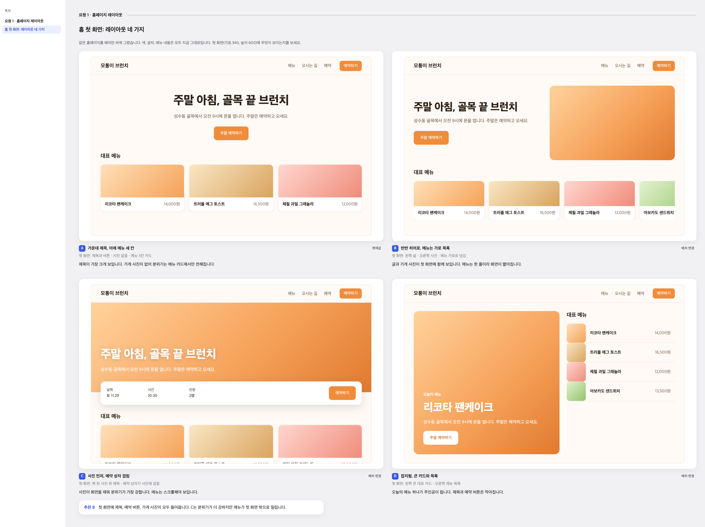
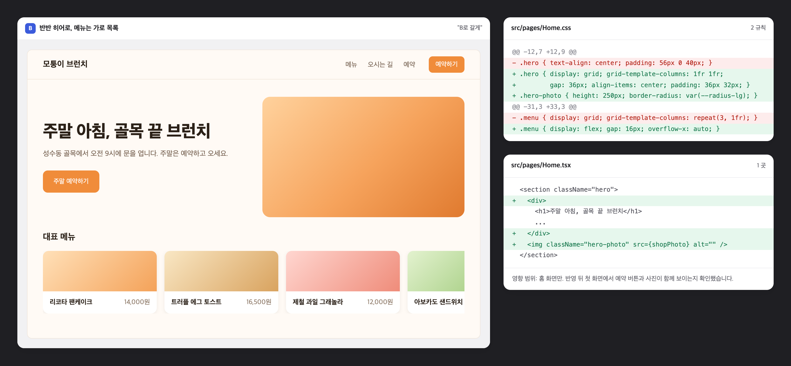

# design-helper

[](https://github.com/Dessert99/design-helper/commits/main)
[](https://github.com/Dessert99/design-helper/releases)

[English](README.md) | [한국어](README.ko.md)

> 디자인 결정을 하나씩, 실제 화면 위에 그려 보고 고르게 하는 Claude Code·Codex 플러그인 (스킬 6개)

**1. "5가지 보여줘": 후보를 비교합니다. 제품 코드는 그대로 둡니다.**



**2. "C로 갈게": 선택한 값을 코드에 반영합니다.**



## 스킬 여섯 개

한 플러그인 안에 스킬이 여섯 개 있습니다. 모두 같은 방식으로 일합니다. 결정 하나를 실제 화면 위에 여러 안으로 그리고, 나란히 놓고 차이에 이름을 붙이면, 사용자가 눈으로 고릅니다. 생성형 디자인 도구처럼 완성품을 한 번에 내놓지 않습니다.

| 스킬 | 정하는 것 | 실행 | 결과물 |
|---|---|---|---|
| `design-helper` | 값 하나(여백, 모서리, 그림자, 색, CSS 전환 시간과 곡선)나 배치 하나 | 말하면 자동 실행 | 코드 반영 |
| `design-system` | 디자인 시스템을 체크리스트 순서로 (글자, 간격, 색, 모양 등) | 이름으로 호출 | 결정 기록 |
| `design-sync` | 결정 기록 중 확정된 값을 코드에 맞추기 | 이름으로 호출 | 코드 반영, AI 안내 블록 |
| `design-ux` | 기능 하나의 흐름, 화면 구성, 상호작용, 상태, 문구 | 이름으로 호출 | 결정 기록 |
| `design-brand` | 아이콘 세트와 로고 방향 | 이름으로 호출 | 결정 기록, 로고 파일 |
| `design-motion` | 여러 요소가 움직이는 순간 (GSAP, Motion, 스크롤 연동) | 이름으로 호출 | 결정 기록 (모션 사양) |

각 스킬은 따로 씁니다. 어느 것도 다른 스킬을 먼저 쓸 필요가 없습니다. 결정 기록은 프로젝트의 `design-decisions/`(노션 링크를 주면 노션)에 쌓이고, 어느 스킬이든 이미 정한 값 위에 다음 안을 그립니다. 아래 "왜 만들었나"부터 "사용법"까지는 자동 실행되는 `design-helper` 이야기이고, 나머지 다섯은 [이름으로 부르는 스킬](#이름으로-부르는-스킬)에 있습니다.

## 왜 만들었나

"시안 5가지만 보여줘"라고 했는데 에이전트가 제품 코드를 먼저 고치면, 비교하기 전에
변경 사항부터 되돌려야 합니다. 숫자만 보고 고르기도 어려워서 값을 넣고 새로고침하는
일을 반복하게 됩니다.

design-helper는 **보여 달라는 요청과 적용해 달라는 요청을 구분합니다.** 비교용 파일을
프로젝트 밖에 만들고 후보를 브라우저에 나란히 띄웁니다. 사용자가 하나를 고르면 그때
프로젝트 코드에 반영합니다.

기존 UI의 테두리, 여백, 그림자나 레이아웃을 여러 버전으로 보고 결정할 때 씁니다.

## 하는 일

한 번 쓰면 이렇게 흘러갑니다.

```
나   카드 그림자 블러를 5가지로 보여줘

     → 프로젝트의 스타일 체계와 지금 카드 값을 읽음
     → 블러만 4 · 8 · 12 · 16 · 24px로 바꾼 카드 A–E를 그려 브라우저에 띄움
       (색, 농도, 위치 같은 나머지는 그대로)
     → 표본마다 값과 비용 표시: 토큰 그대로 · --shadow-md 고침 (23곳) · 새 토큰
     → 표본 아래에 어디서부터 차이가 안 보이는지, 어느 걸 왜 추천하는지 적음
     → 여기까지는 프로젝트 코드를 수정하지 않음

나   C 주변에서 블러를 조금 더 크게 보여줘

     → C를 기준으로 블러를 바꾼 사다리를 아래에 이어 그림 (F · G · H …)

나   G로 갈게

     → 영향 범위 확인 → 실제 카드 코드에 반영 → 결과 확인 → 보고

나   끝났어

     → 서버를 끄고 임시 파일을 지움
```

한 번에 한 속성만 바꾸고 나머지는 그대로 둡니다. 그래서 눈에 보이는 차이는 전부 그 속성
때문입니다. 앞에서 고른 값은 다음 비교에 그대로 깔립니다.

- **보는 동안 제품 코드를 고치지 않습니다.** 시트, 서버, 메모, 스크린샷은 프로젝트 밖
  임시 폴더에 둡니다. 더 보고 싶으면 후보를 이어서 그립니다.
- **고른 뒤에만 반영합니다.** `G로 갈게`처럼 선택하면 영향 범위를 확인하고 코드를
  고칩니다. 값을 직접 옮겨 적을 필요가 없습니다.
- **시트만 봐도 알 수 있게 씁니다.** 섹션마다 무엇을 정하는지, 어디를 보면 되는지, 어떻게
  답하면 되는지를 먼저 적습니다. 표본에는 값과 비용을 붙이고, 얻고 잃는 게 있으면 그것도
  적습니다. 왼쪽 목차에 요청이 쌓여서 앞의 비교로 바로 돌아갈 수 있습니다.
- **새로고침하지 않아도 됩니다.** 시트가 바뀌면 스킬이 탭을 다시 불러와 앞으로 띄웁니다.
  에이전트가 브라우저를 다룰 수 없으면 그렇다고 말하고 시트 주소를 알려 줍니다.
- **대화가 무거워지지 않습니다.** 코드 읽기, 시트 그리기, 확인은 서브에이전트가 하고,
  메인 대화는 말을 전하고 고른 값을 코드에 반영합니다. 그래서 비교를 오래 해도 다른 작업을
  밀어내지 않습니다. 테스트에서는 네 번 주고받는 동안 메인이 약 5천 토큰만 늘었습니다.
  서브에이전트를 쓸 수 없는 환경에서는 메인이 직접 합니다.
- **프로젝트의 스타일 체계로 그립니다.** Tailwind와 CSS 변수는 실제 클래스와 토큰으로
  그립니다. SCSS 변수와 CSS-in-JS 테마는 브라우저가 못 읽으니 값을 읽어서 시트의 CSS
  변수로 옮깁니다. 스타일 체계가 없으면 값을 직접 씁니다.

일꾼은 읽은 지침을 재사용합니다. 다음 턴에는 바뀐 소스와 시트 구역만 읽습니다.
후보에 현재 프로젝트 값이 있으면 `현재값`으로 표시합니다.
시트 장식에는 `dh-` 접두사를 붙여 프로젝트 스타일과 충돌을 줄입니다.

Playwright를 쓸 수 있으면 바뀐 표본의 적용값을 확인합니다.
첫 사다리와 배치 변경에는 스크린샷도 봅니다.
값만 바꿀 때는 `--no-shot`으로 촬영을 생략합니다.
없는 요소·속성, 기대 수 불일치, 리소스 오류와 잘린 표본은 검증에 실패합니다.
첫 화면의 표본 수는 지정한 창 크기와 첫 맥락에서 셉니다.
`NO_PLAYWRIGHT`는 확인하지 못했다는 뜻입니다.
자동 새로고침은 HTML과 CSS 내용을 비교합니다.
같은 초에 같은 길이로 수정하거나 CSS 빌드가 늦어져도 감지합니다.

선택값은 메인이 반영 성공을 알린 뒤 코드 기준값이 됩니다.
정리할 때는 이번 세션이 만든 근거가 있는 파일만 지웁니다.

## 하지 않는 것

- **디자인을 새로 지어내지 않습니다.** 완성된 모습을 만들어 주는 대신 비교할 값의 범위를
  펼칩니다. 표본 아래에 추천과 이유, 얻고 잃는 것을 적긴 하지만 고르는 건 사용자입니다.
- **다음 할 일을 정하지 않습니다.** "다음은 색을 보죠" 같은 제안이나 남은 단계 목록을 내놓지
  않습니다. 다음에 뭘 볼지는 사용자가 정합니다.
- **동작이 맞는지는 확인하지 못합니다.** 포커스 트랩, 키보드 조작, 스크린리더는 눈으로 고를
  수 있는 게 아니라서 design-helper는 다루지 않습니다. 기능의 흐름과 키보드만으로 끝낼 수
  있는지는 `design-ux`가 시안에서 직접 수행해 잽니다.
- **CSS 애니메이션은 사용자가 보고 정합니다.** 스크린샷에는 멈춘 화면만 찍히기 때문에,
  design-helper의 움직임 비교는 사용자가 브라우저에서 보고 말해 준 대로 정합니다. GSAP나
  Motion으로 움직이는 것은 `design-motion`이 실제 라이브러리를 시각마다 옮겨 가며 잽니다.
- **선택 전 코드 변경 여부를 자동 검사하지는 않습니다.** 비교 파일을 프로젝트 밖에 두도록
  지시하지만, `git diff`로 제품 코드가 그대로인지 확인하는 기능은 아직 없습니다.

## 필요한 것

- [Claude Code](https://claude.com/claude-code) 또는 Codex
- 브라우저
- `python3`: 시트를 띄우고 자동으로 새로고침하는 로컬 서버에 씁니다. 없으면 시트를
  `file://`로 여는데, 이때는 자동 새로고침도 없고 30분 동안 요청이 없을 때 임시 폴더를
  지우는 자동 정리도 없습니다.
- Playwright (선택): 계산된 스타일을 읽고 스크린샷을 찍는 데 씁니다. 없으면 이 확인은
  건너뜁니다. `design-ux`의 단계 띠, `design-brand`의 16px 측정, `design-motion`의 프레임 띠와
  측정도 Playwright로 하므로, 이 세 스킬은 Playwright가 있어야 제대로 씁니다.
- 인터넷 (경우에 따라): 프로젝트에 설치돼 있지 않은 아이콘 세트, GSAP, Motion, 서체는 작업
  폴더에 `npm pack`으로 받아 씁니다.

## 설치

### 플러그인으로 설치 (권장)

이 저장소가 두 에이전트 모두의 플러그인 마켓플레이스입니다.

```sh
# Claude Code: 세션 안에서
/plugin marketplace add Dessert99/design-helper
/plugin install design-helper@design-helper

# Codex: 터미널에서
codex plugin marketplace add Dessert99/design-helper
codex plugin add design-helper@design-helper
```

설치한 뒤 세션을 새로 열어야 스킬이 잡힙니다. 여섯 스킬이 모두 `design-helper:` 아래에
등록됩니다. 업데이트할 때는 마켓플레이스를 새로 받고 (Claude Code는
`/plugin marketplace update design-helper`, Codex는 `codex plugin marketplace upgrade`)
다시 설치하면 됩니다.

### clone 해서 설치

스킬을 직접 고치고 싶을 때, 예를 들어 [언어를 바꿀 때](#언어-설정) 이렇게 설치합니다.
clone 한 폴더를 마켓플레이스로 등록하면 플러그인으로 쓰면서 고칠 수 있습니다.

```sh
git clone https://github.com/Dessert99/design-helper.git ~/src/design-helper

# Claude Code: 터미널에서 (세션 안에서는 /plugin marketplace add ~/src/design-helper)
claude plugin marketplace add ~/src/design-helper
claude plugin install design-helper@design-helper

# Codex
codex plugin marketplace add ~/src/design-helper
codex plugin add design-helper@design-helper
```

- **Claude Code**는 이렇게 설치한 플러그인을 clone 폴더에서 바로 읽습니다. 고친 내용은 새
  세션이나 `/reload-plugins`부터 반영됩니다.
- **Codex**는 설치할 때 사본을 만듭니다. 고친 뒤에는 `codex plugin add design-helper@design-helper`를
  다시 실행해야 반영됩니다.

#### 심링크로 설치

플러그인 대신 스킬 폴더를 하나씩 링크할 수도 있습니다. 심링크는 원본을 가리키기만 하므로
clone을 고치면 바로 반영되고, 따로 맞춰 둘 사본도 생기지 않습니다. 플러그인 설치와 섞지
마세요. 같은 스킬이 두 번 등록됩니다. 이 방식에서는 명령어에 `design-helper:` 접두사가
붙지 않습니다(`/design-brand`).

```sh
for s in design-helper design-system design-ux design-brand design-motion design-sync; do
  ln -sfn ~/src/design-helper/skills/$s ~/.claude/skills/$s   # Claude Code
  ln -sfn ~/src/design-helper/skills/$s ~/.codex/skills/$s    # Codex
done
```

두 에이전트 모두 `SKILL.md`의 `description`은 세션을 시작할 때 읽고, 나머지
(`SKILL.md`, `worker.md`, `references/`, 플러그인의 `shared/` 폴더)는 스킬이 실행될 때 읽습니다. 그래서 본문을 고치면
바로 적용되고, `description`을 고쳤을 때만 세션을 새로 열면 됩니다.

심링크로 설치하면 플러그인 에이전트가 없으므로, Claude Code는 대신 일반 서브에이전트에게
`worker.md`를 읽혀 일을 맡깁니다. 동작은 같습니다. 스킬 폴더를 복사하지 말고 clone 안의
폴더에 심링크를 거세요. 스킬은 심링크를 따라 clone으로 돌아가 `shared/` 폴더를 찾습니다.

지우려면 심링크만 지우면 됩니다(`rm ~/.claude/skills/design-*`). clone은 그대로
남습니다.

## 사용법

UI를 만들거나 고치다가 평소처럼 말하면 됩니다. 이런 말에 스킬이 실행됩니다.

`보여줘`, `비교해줘`, `C가 나은데 더 진하게`는 비교를 이어 가는 요청입니다. 후보를
고르겠다는 말이 나오기 전까지 프로젝트 코드는 수정하지 않습니다.

- `버튼 radius 5가지 버전으로 보여줘`
- `A 랑 B 중에 뭐가 나아?`
- `카드 여백 비교해줘`
- `이 헤더 좀 어색한데 어떻게 할까`: 무엇을 바꿀지 아직 모르면 하나씩 물어봅니다.
- `대시보드 레이아웃 잡아줘`: 디자인이 아예 없으면 방향이 크게 다른 조합부터 보여 줍니다.
  여기서 고른 조합은 코드에 넣지 않고 출발점으로만 적어 둔 뒤, 그 위에서 속성을 하나씩
  정합니다.

브라우저에 뜬 표본에는 A · B · C 글자가 붙어 있고, 대답은 채팅으로 합니다.

| 이렇게 말하면 | 이렇게 됩니다 |
|---|---|
| `C로 갈게` · `난 B가 좋아` | 고른 것으로 보고 바로 코드에 반영한 뒤 확인합니다. 빈 화면에서 고른 첫 조합은 출발점으로만 적어 둡니다 |
| `C가 나은데 더 진하게` | 더 비교하고 싶은 것으로 보고 아래에 사다리를 이어 그립니다 |
| `좋네` | 어느 표본인지 되묻습니다 |
| `끝났어` · `됐어` | 서버를 끄고 임시 파일을 정리합니다 |

### 이름으로 부르는 스킬

이름을 불러야만 실행되는 스킬이 다섯 개 더 있습니다. 스스로 실행되지 않고, 각각 따로 쓸 수 있습니다. 어느 것도 다른 스킬을 먼저 쓸 필요가 없습니다.

다섯 모두 design-helper와 같은 방식으로 일합니다. 결정 하나를 실제 화면 위에 여러 안으로 그리고, 사용자가 채팅에서 글자로 고릅니다. 다른 점은 결과물입니다. `design-sync`를 빼면 코드는 고치지 않고, 고른 것을 프로젝트의 `design-decisions/`(노션 링크를 주면 노션)에 기록합니다. 이 기록이 다음 결정과 이후의 코딩이 따르는 기준이 됩니다.

어느 스킬이든 기록을 처음 쓸 때 `AGENTS.md`와 `CLAUDE.md`에 짧은 안내를 넣을지 한 번 묻습니다. 넣으면 이후의 평범한 코딩 세션도 기록을 읽고 정한 값을 따릅니다.

말로 값을 정해도 바로 확정되지 않습니다. "버튼은 8px로 둥글게"라고 해도 시안으로 그려 보여 주고, 고른 뒤에야 확정합니다.

#### design-system: 디자인 시스템을 처음부터

명령어: `/design-helper:design-system` (Codex: `$design-system`)

어디서부터 정해야 할지 모를 때 씁니다. 체크리스트를 따라 한 항목씩 정합니다. 필수는 목적, 글자, 간격, 색, 모양, 구현 방침이고, 그다음 레이아웃, 모션, 컴포넌트를 이어 갈지 묻습니다.

```
나   디자인 시스템 처음부터 잡고 싶어

     → 화면과 코드를 보고 목적과 분위기를 한 줄로 짐작해 확인받음
     → 첫 시트: 지금 디자인과 방향이 다른 출발점 두세 개를 실제 화면 보드에 그림
나   B로 갈게
     → 출발점 기록, 다음 항목(글자 역할 나누기)으로
나   (항목마다 보고 고름)
```

- 후보 값은 지금 코드, 공개 디자인 시스템(Tailwind 기본값, Radix Colors, Open Props, Material 3, shadcn/ui), 직접 만든 값에서 옵니다. 모두 고르기 전까지는 후보입니다.
- 글자 대비와 누르는 영역 크기를 재서 시안에 적습니다. 기준에 못 미치는 시안도 숨기지 않습니다.
- 남는 것: `design-decisions/`의 영역별 파일(글자, 색, 간격, 모양 등)과 체크리스트 진행 상황

#### design-sync: 기록대로 코드 맞추기

명령어: `/design-helper:design-sync` (Codex: `$design-sync`)

기록에서 확정된 값을 코드에 옮길 때 씁니다. 다섯 스킬 중 유일하게 코드를 고칩니다.

```
나   디자인 기록대로 코드 맞춰줘

     → 기록의 확정 값과 지금 코드의 토큰을 비교 (추가, 변경, 같음)
     → 바뀌는 토큰마다 영향 범위를 세고, 실제 화면을 지금과 바꾼 뒤로 나란히 그림
나   색 영역만 먼저
     → 고른 범위만 코드에 반영하고 확인, 토큰 대신 직접 쓴 값이 있으면 알림
```

- 초안이나 보류인 값은 옮기지 않습니다.
- 반영할 때마다 `AGENTS.md`와 `CLAUDE.md`의 짧은 안내를 갱신합니다. 이 안내는 이후의 AI 세션이 기록을 읽고 정한 값만 쓰게 합니다. 안내가 아직 없으면 넣을지 먼저 묻습니다.
- 남는 것: 바뀐 코드, AI 안내 블록

#### design-ux: 기능 하나가 어떻게 동작할지

명령어: `/design-helper:design-ux` (Codex: `$design-ux`)

흐름이나 동작을 정할 때 씁니다. 정지 화면이나 설명으로는 몇 번 눌러야 끝나는지, 어디서 길을 잃는지 알 수 없기 때문입니다. UX 디자이너의 순서를 따릅니다. 목표와 사용자, 과제 단계는 대화로 정하고, 흐름, 화면 구성, 상호작용, 상태, 문구는 시안으로 정합니다.

```
나   주문 취소 처리하는 흐름 다시 잡고 싶어

     → 목표와 과제 단계를 한 줄씩 짐작해 확인받음
     → 흐름 후보(지금, 목록 옆 패널, 상세로 갔다 돌아오기 등)를 동작하는 시안으로 그림
     → 시안마다 과제를 실제로 수행하며 찍은 단계 띠, 클릭 수, 화면 전환 수,
       목록 위치 유지, 키보드만으로 끝낼 수 있는지
나   B로 갈게
     → 흐름 기록, 완료 조건(클릭 3번 이내 등) 제안, 다음은 화면 구성
```

- 시안은 직접 눌러 볼 수 있습니다. 잰 사실과 판단(막히는 단계, 어긴 원칙)은 따로 적습니다.
- 앱 전체 메뉴 구조가 아니라 기능 하나 단위입니다.
- 남는 것: `design-decisions/ux-<과제>.md` (흐름, 패턴, 상태, 문구, 완료 조건)

#### design-brand: 아이콘 세트와 로고

명령어: `/design-helper:design-brand` (Codex: `$design-brand`)

아이콘 세트를 고르거나 로고를 만들 때 씁니다. 로고와 아이콘은 단독으로 보면 멀쩡해도, 16px 브라우저 탭이나 360px 모바일 헤더, 버튼 안에서는 달라 보입니다. 그래서 모든 후보를 실제로 쓰이는 자리에 입혀 비교합니다.

```
나   로고 제대로 만들고 싶어. 형식부터

     → 이름, 하는 일, 성격 세 낱말, 닮으면 안 되는 브랜드를 확인
     → 글자형, 머리글자형, 심볼형, 조합형을 헤더, 모바일 헤더, 16px 탭(8배 확대도),
       앱 아이콘, 어두운 바탕에 그림. 16px에서 흐려지는 정도와 가장 가는 부분을 잼
나   조합형으로
     → 다음은 서체, 심볼 방향, 세부, 작은 크기 판 순서
```

- 아이콘은 공개 세트(Lucide, Phosphor, Tabler, Heroicons, Material Symbols)를 제품이 쓰는 개념으로 비교하고, 세트에 없는 아이콘 수를 셉니다. 굵기, 자리별 크기, 뜻이 갈리는 아이콘(설정: 톱니 또는 조절기)도 하나씩 정합니다.
- 로고는 SVG로만 그립니다. 기존 브랜드를 따라 그리지 않고, 모든 로고 시안에 `상표 검색 안 함`을 표시합니다. 상표 검색은 직접 하셔야 합니다.
- 색은 정하지 않습니다. 기록에 주 색이 있으면 그 색으로 그립니다.
- 남는 것: `design-decisions/icons.md`(세트와 개념별 아이콘 이름), `logo.md`, `assets/brand/`의 로고 파일(SVG, 파비콘, 앱 아이콘 PNG)

#### design-motion: 여러 요소가 움직이는 순간

명령어: `/design-helper:design-motion` (Codex: `$design-motion`)

페이지 진입, 목록 등장, 패널 열기, 스크롤 구간처럼 여러 요소가 움직이거나 GSAP, Motion으로 움직이는 것을 정할 때 씁니다. CSS 속성 하나의 시간이나 곡선은 design-helper가 맡습니다. 모션 디자이너의 순서를 따릅니다. 목적, 안무(무엇이 어떤 순서로), 성격(곡선이나 spring), 시간, 트리거와 끊길 때, 움직임 줄이기 순입니다.

```
나   대시보드 카드 올라오는 거 굼떠. 순서부터 다시

     → 목적(자주 보는 화면인지)과 지금 움직임을 확인
     → 순서 후보(한꺼번에, 차례로, 제목 먼저 등)를 프로젝트의 실제 라이브러리로 재생
     → 재생 막대 하나로 모든 시안을 같은 시계에 맞춰 1배, 0.5배, 0.25배로 보고,
       진행 막대로 한 프레임씩 넘겨 봄
     → 시안마다 프레임 띠와 진행 그래프, 전체 시간, 넘침, 레이아웃이 흔들리는지
나   C로 갈게
     → 기록, 다음은 곡선
```

- 측정은 실제 애니메이션을 시각마다 옮겨 가며 합니다. CSS로 흉내 낸 값이 아닙니다.
- 스크롤 연동은 모든 시안에 같은 스크롤 경로(내림, 올림, 다시 내림)를 재생합니다. 요소가 보이는 자리에서 움직이는지, 다시 올렸을 때 되감기는지를 잽니다.
- 움직임 줄이기(동작 줄이기를 켠 사람이 보는 판)는 건너뛸 수 없습니다.
- 남는 것: `design-decisions/motion-<순간>.md` (대상, 속성, 시간, 곡선, 트리거, 끊길 때, 줄인 판을 담은 사양 표와 참고용 코드)

## 비슷한 스킬과 비교

2026년 9월에 아래 링크의 커밋을 기준으로 살펴봤습니다. 다른 스킬은 대개 **무엇을 만들지**를
돕고, design-helper는 **이미 정한 것의 값을 얼마로 할지**를 돕습니다. 그래서 서로 대신하기보다
같이 쓰기 좋습니다.

**[frontend-design](https://github.com/anthropics/skills/tree/33375500bcea98d610eb30ce10ac4e59b89c390d/skills/frontend-design)** (Anthropic 공식)
- 하는 일: 에이전트가 디자인 리드처럼 생각하게 해서, 흔한 AI 스타일 대신 과감한 미감을 고르게 합니다.
- 차이: 후보를 그려 비교하는 단계가 없고 에이전트가 취향을 정합니다. design-helper는 후보를 그리고 하나를 추천하지만, 고르는 건 사용자입니다.
- 이럴 때 frontend-design: 빈 화면에서 그럴듯한 첫 디자인을 한 번에 얻고 싶을 때. design-helper는 방향을 지어내지 않습니다.

**[playground](https://github.com/anthropics/claude-plugins-official/tree/aecd4c852f10b466245f18383fa6aad8c0b10d57/plugins/playground)** (Anthropic 공식 플러그인)
- 하는 일: 한쪽에 컨트롤, 다른 쪽에 실시간 미리보기가 있는 HTML 파일 하나를 만들고, 조절한 결과를 프롬프트로 복사해 Claude에 다시 붙여 넣게 합니다. 디자인 템플릿 말고도 데이터, 코드 구조, 문서 리뷰 템플릿이 있습니다.
- 차이: 미리보기 하나에 여러 속성의 슬라이더를 달아 한 번에 한 상태만 봅니다. design-helper는 속성 하나만 바꾼 후보를 고정해서 나란히 놓고, 고른 값을 프롬프트로 넘기지 않고 직접 코드에 반영한 뒤 확인합니다.
- 이럴 때 playground: 정답이 하나로 모이지 않는 조합을 직접 만져 보며 감을 잡고 싶을 때, 디자인이 아닌 것을 탐색하는 도구가 필요할 때.

**[impeccable](https://github.com/pbakaus/impeccable/tree/9d715cc4f5564a990ca8345abfdd5df6dc9b41c8)** (pbakaus)
- 하는 일: 디자인 용어집, 안티패턴 검출 규칙, `audit` · `polish` · `typeset` · `layout` 같은 명령을 줍니다. live 모드에서는 실행 중인 앱에서 요소를 골라 여러 변형을 브라우저에서 넘겨 보고, 마음에 든 변형을 소스에 씁니다. 기존 CSS 토큰과 계산된 스타일을 읽고, 변형마다 조절 슬라이더를 붙일 수도 있습니다.
- 차이: 가장 비슷한 스킬입니다. impeccable은 요소를 통째로 다시 만들어서 여러 속성이 한꺼번에 바뀌고, 변형을 하나씩 넘겨 봅니다. design-helper는 속성 하나만 바꾼 사다리를 한 화면에 나란히 놓고, 표본마다 토큰에 미치는 영향을 적습니다.
- 이럴 때 impeccable: 실제 앱 화면에서 바로 고르고 싶을 때, 디자인 점검과 다듬기를 명령 하나로 돌리고 싶을 때.

**[visual companion](https://github.com/obra/superpowers/blob/8ca22dba9a94f28898bbce59f2537ff4d87c747d/skills/brainstorming/visual-companion.md)** (obra/superpowers의 brainstorming 스킬 일부)
- 하는 일: 구현 전에 아이디어를 짜는 단계에서 목업, 다이어그램, 나란히 비교를 브라우저에 띄우고 클릭으로 고르게 합니다. 간격이나 시각적 위계를 다듬을 때도 씁니다.
- 차이: 한 속성만 바꾸는 사다리, 고른 뒤 코드 반영, 반영 후 확인을 정해진 절차로 두지 않습니다. design-helper는 이 셋이 기본입니다.
- 이럴 때 visual companion: 아키텍처 다이어그램처럼 UI가 아닌 것도 그려야 할 때, 구현 전에 방향을 잡을 때.

**[design-shotgun](https://github.com/garrytan/gstack/blob/2a113ae7e623f590095bcaaa0cc581c9a10a6632/design-shotgun/SKILL.md.tmpl)** (garrytan/gstack)
- 하는 일: 이미지 생성으로 서로 다른 시안을 3~8장 만들어 비교 보드에 띄우고, 평가와 메모를 받아 다시 만듭니다. 마음에 들어 한 취향을 기억합니다.
- 차이: 결과물이 코드가 아니라 이미지(PNG)라서 코드 반영은 다른 스킬이 해야 합니다. 이미지 생성 도구도 필요합니다. design-helper는 별도 도구 없이 CSS로 그립니다.
- 이럴 때 design-shotgun: 아직 뭘 원하는지 모르겠고 넓게 여러 방향을 보고 싶을 때.

**design-helper만의 방식**: 선택 전에는 프로젝트 밖에서 후보를 비교합니다. 한 속성만 바꾼 사다리를 나란히 놓고 영향 범위와 추천을 보여 줍니다. 사용자가 고르면 코드에 반영하고 확인합니다.

**design-helper의 약점**: 완성된 디자인 방향을 먼저 내놓지 않고, 안티패턴을 자동으로 찾아 주지 않고, 실제 앱이 아니라 따로 띄운 시트에서 비교하고, 기본 답변이 한국어뿐입니다.

## 언어 설정

지시문은 영어지만 채팅 답변과 비교 시트의 글자는 모두 한국어입니다. 코드, 클래스 이름,
파일 이름, 커밋 메시지는 영어로 씁니다.

다른 언어로 바꾸려면 [clone 해서 설치](#clone-해서-설치)한 뒤 `shared/core.md`의
`## Language` 섹션을 고치면 됩니다. GitHub에서 바로 설치한 플러그인 파일은 업데이트할 때마다
덮어써지니 고쳐도 남지 않습니다. 지시문 곳곳에 따옴표로 들어간 한국어 문구(`토큰 그대로`, `끝났어` 등)도
같이 바꿔야 합니다.

## 문서

- [`skills/design-helper/`](skills/design-helper/): 비교 스킬
  - [`SKILL.md`](skills/design-helper/SKILL.md): 메인 에이전트가 먼저 읽는 지침. 스킬이 있는 이유, 플러그인 경로 찾는 법, 실행할 worker 지침
  - [`worker.md`](skills/design-helper/worker.md): 이 스킬만의 규칙. 작업 단위, 표본 그리는 규칙, 대답 해석, 기록, 영향 범위, 마무리
  - [`references/sweeping.md`](skills/design-helper/references/sweeping.md): 후보 값, 캡션과 추천, 배경·크기 조건, 빈 화면에서 시작하기, 실제 디자인으로 그리는 배치 비교(회색 뼈대는 요청할 때만)
  - [`references/motion.md`](skills/design-helper/references/motion.md): 애니메이션 비교
- [`skills/design-system/`](skills/design-system/): 체크리스트로 디자인 결정 기록을 만드는 스킬. [`references/checklist.md`](skills/design-system/references/checklist.md)에 기본 항목, 역할, 의도, 검사가, [`references/imports.md`](skills/design-system/references/imports.md)에 값을 가져올 수 있는 공개 시스템이 있습니다
- [`skills/design-ux/`](skills/design-ux/): 기능 하나가 어떻게 동작할지 정하는 스킬. [`references/patterns.md`](skills/design-ux/references/patterns.md)에 후보를 고르는 패턴 목록, [`references/evaluate.md`](skills/design-ux/references/evaluate.md)에 워크스루, 10가지 원칙, 상태 목록이 있습니다
- [`skills/design-brand/`](skills/design-brand/): 아이콘 세트와 로고 방향을 고르는 스킬. [`references/icons.md`](skills/design-brand/references/icons.md)에 공개 아이콘 세트 목록, [`references/logo.md`](skills/design-brand/references/logo.md)에 형식, 서체, 심볼 방향과 다른 브랜드와 닮지 않게 하는 규칙이 있습니다
- [`skills/design-motion/`](skills/design-motion/): 한 순간이 어떻게 움직일지 정하는 스킬. [`references/choreography.md`](skills/design-motion/references/choreography.md)에 안무, 곡선, 시간 후보가, [`references/libraries.md`](skills/design-motion/references/libraries.md)에 GSAP와 Motion을 시안에 넣고 연결하는 법이 있습니다
- [`skills/design-sync/`](skills/design-sync/): 기록에 맞춰 코드를 바꾸는 스킬
- [`shared/`](shared/): 플러그인의 모든 스킬이 함께 쓰는 것
  - [`decisions.md`](shared/decisions.md): 결정 기록의 구조, 상태, 규칙, `기록 지시:` 넘김
  - [`board.md`](shared/board.md): 모든 스킬이 시안을 그리는 실제 화면 보드. 구역마다 따로 떠 두는 페이지
  - [`agent-guide.md`](shared/agent-guide.md): 이후의 AI가 기록을 따르게 하는 안내 블록과 넘기기 전 점검
  - [`main.md`](shared/main.md): 메인 에이전트가 스킬을 실행하는 방법. 일을 서브에이전트에게 맡기고 사용자와 서브에이전트 사이에서 말을 전해, 메인 대화가 가볍게 유지됩니다. 서브에이전트를 쓸 수 없으면 메인이 직접 합니다
  - [`core.md`](shared/core.md): 모든 worker가 가장 먼저 읽는 규칙. 결정 루프와 원칙, 메인을 통해 말하기, 언어, 발견 사항, 검증, 시트
  - [`clarification.md`](shared/clarification.md): 요청이 모호할 때 묻는 법
  - [`writing.md`](shared/writing.md): 사용자가 읽는 모든 한국어 문장을 쓰는 법. 짧은 문장, 기호 줄임 금지, 조사 붙여 쓰기, 캡션 배치
  - [`sheet.md`](shared/sheet.md): 시트 페이지의 요청 구분선, 목차, 배치, 스타일
  - [`stylesystems.md`](shared/stylesystems.md): 스타일 체계를 알아내고 체계별로 그리는 법
  - [`controls.md`](shared/controls.md): 필요할 때만 쓰는 슬라이더와 지켜야 할 규칙
  - [`liveview.md`](shared/liveview.md): 임시 작업 폴더, 로컬 서버, 브라우저 탭 관리, 정리
  - [`assets/`](shared/assets/): 일꾼이 매번 새로 쓰지 않고 복사해서 쓰는 고정 파일
    - [`sheet.html`](shared/assets/sheet.html): 스타일, 목차, 자동 새로고침이 들어 있는 빈 비교 페이지
    - [`serve.py`](shared/assets/serve.py): 브라우저로 시트를 연 뒤 30분 동안 요청이 없으면 스스로 정리하는 로컬 서버
    - [`check.cjs`](shared/assets/check.cjs): Playwright로 계산된 스타일을 읽고 스크린샷을 한 번에 찍는 스크립트
    - [`walk.cjs`](shared/assets/walk.cjs): 시안에서 과제를 실제로 수행하며 단계 띠를 찍고 클릭 수, 화면 전환, 키보드만으로 완료를 재는 스크립트
    - [`icons.cjs`](shared/assets/icons.cjs): 공개 아이콘 세트를 개념별로 모으고 없는 아이콘, 획 두께, 라이선스를 알려 주는 스크립트
    - [`pixel.cjs`](shared/assets/pixel.cjs): 로고를 실제 크기로 그려 작은 크기는 키워 보여 주고, 흐려지는 정도와 가장 가는 부분을 재고, 글자를 윤곽선으로 바꾸고 PNG를 뽑는 스크립트
    - [`motion.js`](shared/assets/motion.js): 한 구역의 모션 시안을 한 시계로 재생하는 재생 막대와, 시안이 GSAP나 Motion을 연결하는 연결부. 스크롤 연동 시안은 정해진 스크롤 경로를 시계로 삼습니다
    - [`motion.cjs`](shared/assets/motion.cjs): 시안의 실제 애니메이션을 정해진 시각으로 옮겨 프레임 띠, 진행 그래프, 측정값을 만드는 스크립트
- [`agents/worker.md`](agents/worker.md): 모든 스킬이 띄우는 Claude Code 플러그인 에이전트. `shared/core.md`와 스킬의 `worker.md`를 읽습니다. Codex 플러그인은 에이전트를 담을 수 없어서, Codex에서는 일반 서브에이전트를 띄웁니다
- [`scripts/bump-version.sh`](scripts/bump-version.sh): 플러그인 매니페스트의 버전을 한 번에 바꾸고 커밋과 태그까지 만드는 스크립트

키트 회귀 검사는 브라우저 설치 없이 실행합니다.
HTTP 응답, 새로고침 판단과 검사기 보고서를 확인합니다.
실제 렌더링이 맞는지는 별도 확인해야 합니다.

```sh
python3 scripts/test-kit.py
node scripts/test-reloader.cjs
node scripts/test-check.cjs
python3 scripts/test-skills.py   # frontmatter, 실행 설정, 지침 속 경로
```

결정 기록의 구조와 AI 안내 블록은 [Astryx](https://github.com/meta/astryx)(MIT)가 AI에게
디자인 의도를 지키게 하는 방식을 참고했습니다. design-ux의 단계는 Double Diamond와 Nielsen
Norman Group의 과제 분석, 워크스루, 10가지 원칙을, design-motion의 라이브러리 수칙은
GreenSock의 [gsap-skills](https://github.com/greensock/gsap-skills)(MIT)를 참고했습니다.
모두 방법만 빌렸고 문장이나 값은 복사하지 않았습니다.

## 라이선스

[MIT](LICENSE)
